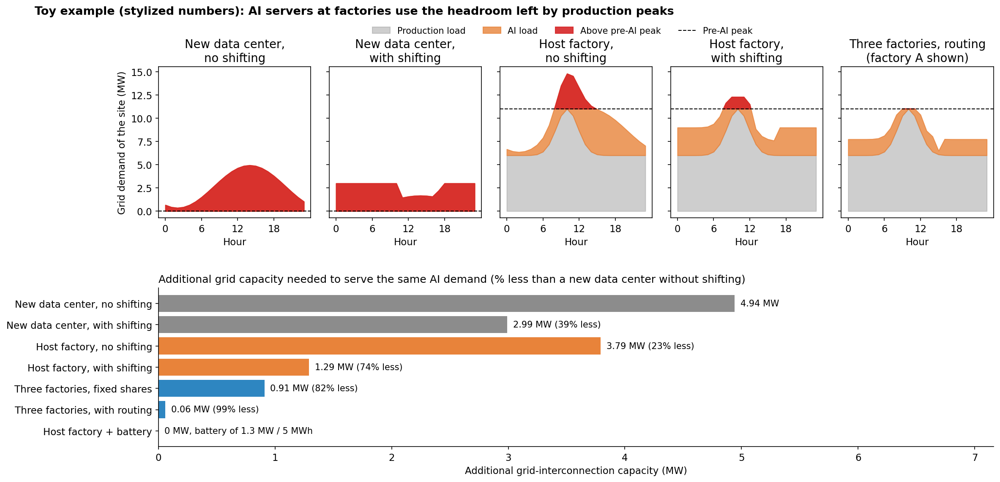

# Coordinating Distributed AI Servers with Industrial Loads to Reduce Grid-Interconnection Needs

Code and data for the paper by **Ruike Lyu and Bolun Xu** (Columbia University).

The study explores four ways of deploying AI servers to meet the inference demand of manufacturers in China:
- new large data centers (LDC), which serve the demand at new sites without existing load or grid connections;
- per-factory deployment (PFD; code label `PF`), in which each factory runs its own AI services on site;
- host-factory deployment (HFD; code label `SHG`), in which one factory of each corporate group hosts the AI services
  of all its factories;
- multi-site deployment (MSD; code label `MSG`), in which up to five factories of a group host servers and tasks are
  routed among them within their deadlines.

For each deployment, it computes the additional grid-interconnection capacity needed when the AI load is scheduled
together with the factories' measured production load. It also reports the water, floor-space and land requirements,
and the annual enterprise payments compared with cloud procurement.

## The mechanism at a glance



A toy corporate group with three factories, whose production peaks are eight hours apart, serves its AI demand
(one third firm, two thirds deferrable by up to 12 hours) over one day. The figure uses **stylized numbers, not paper
results**, and is computed by the same model as the paper (eq. 1a–1i) with the open-source HiGHS solver.

| Step | Case | Additional grid capacity (MW) |
|---|---|---|
| 1 | New data center, no task shifting | 4.94 |
| 2 | New data center, with task shifting | 2.99 |
| 3 | Host factory, no task shifting | 3.79 |
| 4 | Host factory, with task shifting | 1.29 |
| 5 | Three factories, fixed shares | 0.91 |
| 6 | Three factories, with routing | 0.06 |
| 7 | Host factory (step 4) with a 1.3 MW / 5 MWh battery | 0 |

A factory's connection is sized for its production peak, so part of the AI load fits within the unused headroom. Steps
1–4 separate the two parts of this first mechanism: co-location alone cuts the additional capacity by 23% (step 1 → 3),
and by 57% when flexible tasks can also be shifted out of the production peak (step 2 → 4). The second mechanism is
routing: with servers at all three factories, tasks run wherever there is headroom, and the additional capacity almost
disappears (step 5 → 6). A behind-the-meter battery can shave what remains (step 7).
The notebook [demo/mechanism_demo.ipynb](demo/mechanism_demo.ipynb) walks through each step; rerun it with

```bash
cd demo && jupyter notebook mechanism_demo.ipynb   # or: python demo/mechanism_demo.py
```

## What you can reproduce

| Level | What it does | Needs | Time |
|---|---|---|---|
| **1. Rebuild from saved results** | Reruns every step after the optimization: national totals, site-capacity distributions, the mechanism decomposition, demand, water, floor-space, land and payment results, and the paper figures. Then checks that every regenerated CSV matches the shipped one. | This repository only. No solver. Three steps need downloaded third-party files and are otherwise skipped (see below). | ~1 min |
| **2. Full re-solve** | Reruns the 31-industry optimizations (PF, SHG, MSG and the LDC counterfactual) and everything downstream. | Level 1, plus EWELD (downloaded by script), an hourly price series (see below) and Gurobi. | several hours on a multi-core server |

### Level 1: rebuild from saved results

```bash
conda env create -f environment.yml
conda activate distributed-ai-grid
python 08_code/reproduce_paper_results.py      # or: make reproduce
```

Three steps read third-party original files that are not shipped (see [DATA_SOURCES.md](DATA_SOURCES.md), "Not included"):
the Epoch AI snapshot, the WRI Aqueduct country-rankings archive and the U.S. statistics extracts. Without them, the script
skips those steps and keeps their shipped outputs: the interconnection node distribution (Epoch AI), the spatial water audit
(Aqueduct) and the U.S. manufacturing AI demand. To rebuild them, download the files to the paths below, then rerun the script.

| Step skipped without the file | Download to |
|---|---|
| Interconnection node distribution | `02_data/raw/epoch_ai/ai_data_centers/2026-09-10/data_centers.csv` and `data_center_timelines.csv` |
| Spatial water audit | `02_data/raw/resource_footprint/water_stress_sources/aqueduct40/aqueduct-4-0-country-rankings.zip` |
| U.S. manufacturing AI demand | `02_data/raw/curated/us_manufacturing_activity_naics3_2022.csv`, `us_manufacturing_mecs_2022.csv` and `us_manufacturing_berd_2023.csv` (extracts of the 2022 Economic Census, EIA MECS 2022 and NSF BERD 2023, with source URLs in the files; U.S. results are not in the paper) |

The script prints each step and ends with `All regenerated CSV files match the shipped results.`
The figures are written to `05_results/v1.0.0/result/manuscript_figures/`.
`python 08_code/reproduce_paper_results.py --list` shows the exact commands. They are the same commands the
Snakemake workflow runs.

### Level 2: full re-solve

1. Download the EWELD load profiles (258 MB, CC BY 4.0, checked against the published MD5):
   ```bash
   python 08_code/fetch_external_data.py     # or: make fetch-data
   ```
2. **Hourly electricity prices.** The paper uses Guangdong day-ahead prices for 28 May – 3 June 2026 plus
   regulated volumetric adders (`config/defaults.yaml`, `energy`). That price series comes from a third party and
   **is not redistributed here**. You have two options:
   - **Supply a price file** at the path given by `paths.spot_price_source` in `config/defaults.yaml`. It needs the
     columns `business_date`, `business_hour`, `province_code`, `settlement_type` and `price_rmb_mwh`, with four
     15-minute values per hour for the configured week (see `read_core_grid_energy_prices` in `08_code/core/data.py`).
   - **Use the flat tariff:** set `energy.grid_energy_price_mode: flat_tariff` in `config/defaults.yaml`.

   The price enters the objective through energy costs and therefore affects how flexible tasks are scheduled.
   With a different price series, results can differ from the published ones.
3. **Solver.** The published results use Gurobi 13.0.2 (relative MIP gap 1e-3). Free academic licences are
   available from Gurobi. To use HiGHS instead, set `model.solver.name: highs` in `config/defaults.yaml` and
   `solver: highs` in `config/scenarios/group_multisite_core_v1.yaml`. HiGHS was not used for the published runs and has not been tested on the
   full workflow.
4. Run the workflow:
   ```bash
   snakemake paper --cores 8 --forceall  # or: make full-run CORES=8
   ```

## Repository layout

| Path | Contents |
|---|---|
| `08_code/` | Data preparation, the optimization model (`core/`, `run_group_architecture_core.py`, `run_national_cloud_center.py`), post-processing, and figure scripts |
| `config/` | Model defaults, scenario and sensitivity registries, demand, hardware and cost cases |
| `workflow/`, `Snakefile` | Snakemake rules; `snakemake paper` builds everything used in the paper. The rule files also define analyses from the wider project whose scripts are not part of this release; they are not needed for `paper`. |
| `02_data/` | Author-compiled parameters, processed model inputs, and redistributable third-party extracts (see [DATA_SOURCES.md](DATA_SOURCES.md)) |
| `05_results/v1.0.0/` | Saved model outputs and every downstream result and figure |
| `05_results/sensitivity/v1.0.0/` | LDC counterfactual, the no-shift paired run, and the national comparison |
| `demo/` | Stylized mechanism demo: notebook, model module and the README figure |
| `docs/si.pdf` (source `docs/si.tex`) | Supplementary Information: data sources, equations and assumptions behind the paper's results |
| `docs/assumptions.md` | Every modelling assumption: value, range, basis or source, and the file where it is set |
| `docs/paper_map.md` | Where each figure, table and headline number in the paper comes from |
| `tests/` | Unit tests: `python -m unittest discover -s tests` |

Script names keep the internal research-question numbering. For example, the data behind the paper's Fig. 3 are built by
`build_figure3_rq1_grid_capacity.py`, and the paper's Fig. 1 (architecture schematic) by `build_gm_figures.py`. [docs/paper_map.md](docs/paper_map.md) gives the correspondence.

Some data files keep Chinese-language values, for example industry and province names and source titles,
because they are copied from Chinese statistical sources. Code that matches these values relies on them as-is.

## Data and licences

- Code: MIT licence ([LICENSE](LICENSE)).
- Author-compiled data and model results: CC BY 4.0 ([LICENSE-DATA](LICENSE-DATA)).
- Third-party data keep their original licences. [DATA_SOURCES.md](DATA_SOURCES.md) lists every source, its
  licence, and how it is used or obtained. Two inputs are not included:
  - the hourly price series (no redistribution permission);
  - the Chinese province boundary files (not redistributable; they were only used for a map that is not part of the paper).

## Citation

See [CITATION.cff](CITATION.cff). Please cite the paper and this repository.
